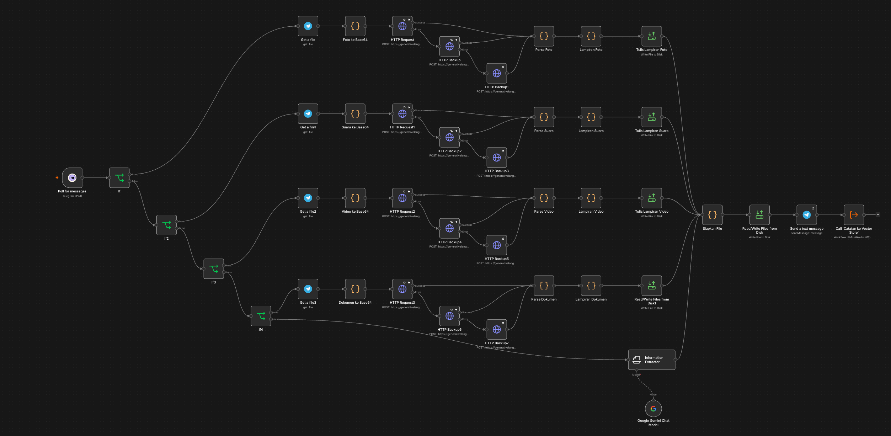

# Second Brain Intake - n8n

Send anything to a Telegram bot: text, photo, voice note, video, PDF, Word or Excel. It lands in an Obsidian vault as a structured Markdown note, together with the original file.

> Companion project: [Tanya Catatanku](../ask-my-note) is the retrieval side that answers questions over the notes this workflow writes. Both share the `Catatan ke Vector Store` ingest sub-workflow.

## Problem

Notes arrive in whatever form is at hand: a photo of a slide, a voice memo on the way home, a PDF from a webinar, a link pasted into chat. Filing each one by hand means it either gets done days later or not at all, and the reasoning behind the note is lost by then. Doing nothing is worse: the note never becomes searchable.

## How it works

1. **Poll for messages** (community Telegram node) receives the update. A webhook trigger is not usable here because the instance has no public HTTPS URL.
2. A chain of **If** gates classifies the message: photo, voice, video, PDF, other document, spreadsheet, or plain text. Text leaves only through the last gate's false branch.
3. Each media branch downloads the file from Telegram, converts it to base64 in a Code node, and posts it to the Gemini API with a prompt that asks for JSON: `{judul, isi, tags}`. Voice notes additionally return a verbatim `transkrip`.
4. **Siapkan File** builds the Markdown: YAML frontmatter, an `![[attachment]]` embed, the body, the tags as a YAML list, and the note filename `YYYY-MM-DD_Title`.
5. **Read/Write Files from Disk** writes the note to `/vault/2nd-brain/notes` and the original media to `/vault/2nd-brain/lampiran`.
6. **Send a text message** confirms to the user, then the ingest sub-workflow re-indexes the note for the RAG chatbot.

## Results

- **43 nodes**, **7** input types supported end to end.
- **7** notes and **6** attachments in the vault, all searchable in Obsidian.
- Retry on Fail (3 attempts, 5 s apart) on every Gemini call and on the Telegram reply, so a provider spike or a long voice note does not lose the note.

## Stack

n8n 2.39.8, Google Gemini API (vision and audio), Telegram Bot API, community node `n8n-nodes-telegram-getupdates-api`, Obsidian vault bind-mounted into the container.

## Import

1. Download `second-brain-intake.json`.
2. Install the community node **Telegram (Poll)** from Settings -> Community nodes.
3. In n8n: Workflows -> Create Workflow -> **...** -> Import from File.
4. Add two credentials: a Telegram Bot token (type _Telegram Bot Token_) and a Header Auth credential named `x-goog-api-key` holding your Gemini key.
5. Mount your Obsidian vault into the container and set `N8N_RESTRICT_FILE_ACCESS_TO` to include it, otherwise file writes fail with "Access to the file is not allowed".
6. Send a real message to the bot to test, then Publish.

## What I learned

- **`exists` is the wrong If operator for a ternary.** `{{ $json.message.photo ? 'y' : '' }}` is never undefined, so `exists` is always true and every message enters the photo branch. It has to be **is not empty**.
- **A media file cannot live inside a Markdown file.** Obsidian renders images from real files on disk, so "one .md file only" and "the photo shows up in the note" are mutually exclusive. Notes and attachments live in sibling folders and the embed uses the bare filename.
- **`new Date()` in a Code node is UTC** regardless of the container timezone, so every timestamp is built by shifting the epoch and reading the UTC getters.
- **A model ID is a moving target.** Gemini retires versions quickly and the error message names the replacement, so the URL segment needs re-checking rather than assuming.
